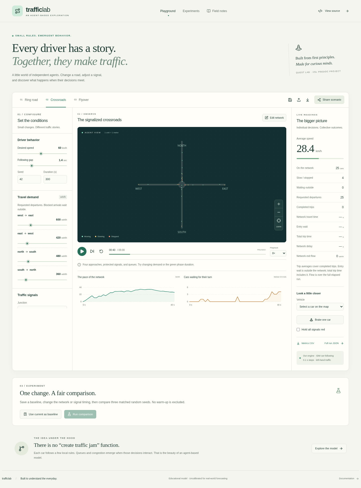

# Traffic Lab

A full-stack, interactive agent-based traffic laboratory for the Quest lab, IISc
predoc project. The simulation engine, network model, editor, and measurements
are implemented in this repository using published traffic models.



## Try it locally

Use Node.js 24 LTS (see `.nvmrc`) and npm:

```bash
npm ci
npm run dev
```

Open port 3000 in your local browser. No database, accounts, API keys, or external
map service are needed for local development. Scenario sharing uses an ignored
`.local/scenarios/` directory on the development server. Local browser saves and
JSON exports work independently of the backend.

For a local production build with local server storage:

```bash
npm run build
TRAFFIC_STORAGE=local npm start
```

Local server storage is deliberately rejected on Vercel/Netlify. Configure the
Supabase adapter for durable sharing there; see [deployment](doc/deployment.md).

## What you can do

- Explore a ring road, signalized crossroads, or a flyover with a ramp merge.
- Run, pause, single-step, reset, and change playback speed.
- Change population or departure demand, driver speed/gap, lane count, lane
  width, road speed limits, signal timing, and phase offsets.
- Inspect a vehicle and brake it to observe the effect on its neighbors.
- Edit networks: add/move/remove nodes, connect directed roads, change levels,
  edit origin/destination demand, and add/remove signal controllers.
- Watch speed, queues, travel time, entry waiting, trip completion, and flow.
- Save and load scenarios locally, import/export JSON, and export metrics CSV.
- Save a baseline and compare three paired seeds with mean and variation.
- Share read-only scenarios with saved run summaries; the creator can update
  or delete the shared copy using a private key retained in their browser.

Shared links contain no edit key. Anyone with a link can read that scenario.
Clearing browser storage loses edit access; there is no account recovery.
Run summaries are client-generated, not independently verified server results.

## Commands and checks

```bash
npm run check             # formatting, TypeScript, unit/API/database tests, build
npm run test:e2e          # builds and tests desktop/mobile Chromium
npm run experiment -- --preset junction --seed 42 --duration 300
npm run experiment -- --preset flyover --timestep 0.05 --output .local/run.json
```

Install a test browser once with `npx playwright install chromium`. On Linux,
`npx playwright install --with-deps chromium` also installs system prerequisites
when you have permission. An existing browser can be selected with
`PLAYWRIGHT_CHROMIUM_EXECUTABLE_PATH=/path/to/chromium`.

Headless experiments can read an exported scenario with `--scenario file.json`.
Available presets are `ring`, `junction`, and `flyover`; supported timesteps are
0.05, 0.1, and 0.2 seconds. Full exports include the scenario, engine version,
timestep, sampled metrics, and timed interventions. CSV metric units match the
SI units in the engine: seconds, meters/second, and vehicles/hour.

## Model and scope

Vehicles follow IDM car-following rules. The engine uses fixed timesteps,
simultaneous state updates, seeded arrivals/driver variation, lane-local leader
lookup, explicit junction connectors, and conservative conflict reservations.
Lane assignment is fixed; discretionary overtaking is not implemented. Roads
that cross visually have no connection unless connected by node IDs.

Width changes geometry, while lane count and traffic interactions affect flow.
Blocked arrivals wait outside the network and remain in demand accounting.
The demo caps active vehicles at 300, with excess demand retained in that queue.

This is an educational, uncalibrated lane-based model. It does not predict real
Bengaluru traffic or represent mixed, lane-free motorcycle/bus/car behavior.
Read [implementation and limitations](doc/implementation.md) before interpreting
experiments. Deployment has not been performed.

## Learn while building

- [Concepts in plain language](doc/concepts.md)
- [Implementation decisions](doc/implementation.md)
- [Research and open-source references](doc/research.md)
- [Architecture](doc/architecture.md)
- [Roadmap and scope](doc/roadmap.md)
- [Verification evidence](doc/verification.md)
- [Deployment handoff](doc/deployment.md)

The original research proposal is retained in `doc/`; implementation notes
record the choices made while turning it into the working application.
