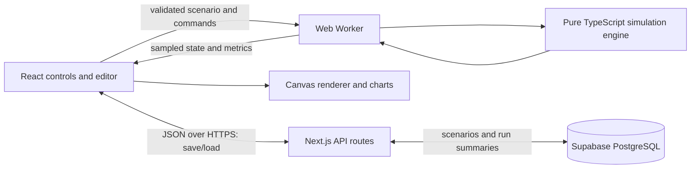

# Proposed architecture

## Stack and reasons

| Part | Proposed choice | Why |
| --- | --- | --- |
| Language | TypeScript | One language for UI, engine, worker, and API; catches many mismatched data shapes. |
| Web app | React with Next.js App Router | Components for controls and dashboards, plus API routes in one deployable project. |
| Styling | Tailwind CSS | Consistent spacing, typography, and responsive panels with little custom infrastructure. |
| Network rendering | Canvas 2D | Direct drawing of roads and many moving cars, without a React component per vehicle. |
| Simulation execution | Our TypeScript engine in a Web Worker | Calculations run separately from the UI thread. |
| Charts | Recharts | React integration for a few sampled time series. |
| API validation | Zod | Check imported and saved scenarios at runtime; TypeScript alone cannot validate JSON. |
| Persistence, later | Supabase PostgreSQL | Durable scenario/result storage without operating a database server. |
| Ownership, later | Supabase Auth | Protect editing/deletion of shared scenarios when cloud saving arrives. |
| Verification | Vitest and Playwright | Engine tests and real browser interaction checks. |
| Deployment | Vercel first; Netlify alternative | Host the web app and short API requests. |

No simulation framework will supply the engine. Frameworks handle the ordinary
web application work, while we implement agents, roads, routing, control,
measurements, and the editor. Pin supported stable dependencies and a compatible
Node LTS when implementation begins; avoid choosing versions before installation.

The first milestones need no database: bundled scenarios, local storage, and JSON
import/export are enough. Cloud storage is the later step that completes the
full-stack demo. Next.js is chosen for that path; a purely local simulator could
use React with Vite, but would need a separate API when sharing is introduced.

## Communication



The browser receives the application from the host, then runs the live
simulation locally. It does not request a backend update for every vehicle or
simulation step. A Web Worker is a separate browser execution context; messages
cross its boundary, and it cannot directly edit the page.

Worker commands: initialize, play, pause, reset, step, and set playback speed.
Worker replies: ready, state snapshot, metrics sample, completed, or error.
Include a run identifier so old messages cannot overwrite a newly reset run.
Coalesce snapshots rather than queuing unlimited rendering work.

Proposed starting rates: a fixed 0.1-second physics step, state snapshots at
roughly 10–20 Hz, and metric samples once per simulated second. Rendering uses
requestAnimationFrame and may interpolate snapshots. These are starting settings
to validate, not measured performance claims. Keep counts of requested physics
steps; do not make physics depend on message timing or monitor refresh rate.

## Keep modules small

Planned boundaries, not folders created yet:

```text
src/
  simulation/   # network, agents, following, routing, junctions, metrics, RNG
  workers/      # scheduler and message protocol
  renderer/     # geometry, canvas drawing, selection/hit testing
  features/     # editor, controls, charts, scenario comparison
  schemas/      # versioned scenario and result formats
  app/          # pages and short API routes
doc/            # brief concepts, decisions, and experiment notes
```

The engine takes a scenario, seed, and timestep; it advances state and returns
data. It must not import React, Canvas, a database SDK, or browser globals.
This allows the same engine to run in unit tests and, later, Node batch jobs.
Start with ordinary arrays and lane-local ordering. Avoid comparing every car
with every other car; each car mainly needs its lane's next vehicle.

## Data model

- **Scenario:** schema version, name, network, demand schedule, signals, model
  parameters, duration, seed, and driving side.
- **Network:** nodes, directed roads, lanes, and explicit lane connectors through
  junctions. Geometry and physical lengths use meters.
- **Vehicle state:** stable ID, lane/connector, distance along it, speed, length,
  driver parameters, route, requested departure, actual entry, and arrival time.
- **Run result:** scenario revision/hash, engine version, seed, timestep, demand
  schedule, metrics, and bounded time-series samples.

Keep editable scenario configuration separate from the engine's changing state.
Use schema versions so a future format change can be rejected or migrated.
Road geometry edits require pause and reset; a future live-control mode can log
signal commands at specific simulation ticks for replay.

## Backend and persistence milestone

Initially support creating/loading scenarios, owner updates/deletes, public
read-only links, and saving run summaries. Example resources are
`/api/scenarios`, `/api/scenarios/:id`, and `/api/runs`.

Two main tables suffice: scenarios (owner, revision, JSON configuration, visibility)
and runs (scenario revision, engine version, seed, summaries, sampled metrics).
Use database migrations, request size limits, input validation, and ownership
checks. Apply database row policies too. Keep privileged database credentials
server-side; never embed them in frontend code. Do not offer unrestricted
anonymous writes without abuse controls.

Saved client-generated summaries are user-supplied results, not server-verified
measurements. Retain the input/version metadata needed to reproduce them. If
authoritative batch runs become necessary, execute the same engine on a separate
job service and record where each result came from.

## Deployment boundaries

Vercel hosts Next.js, static assets, the worker bundle, and API routes. Netlify is
an alternative using its Next.js runtime. Supabase supplies persistent storage.
Do not use process memory or the host's local filesystem as the saved database.

Short HTTP requests fit scenario saving and loading. A long simulation should
not depend on a serverless request staying alive, and this design needs no
persistent WebSocket server. If large batch experiments later exceed browser
resources, add a dedicated worker service on an appropriate compute host then.

Browser performance depends on the user's machine; benchmark representative
networks before advertising vehicle limits. Start with tens of vehicles, then
test hundreds. Define a public cap from measurements. Pause when a tab is hidden
and explain that background tabs may be throttled. Show local save/export and
clear errors when cloud persistence is unavailable.
