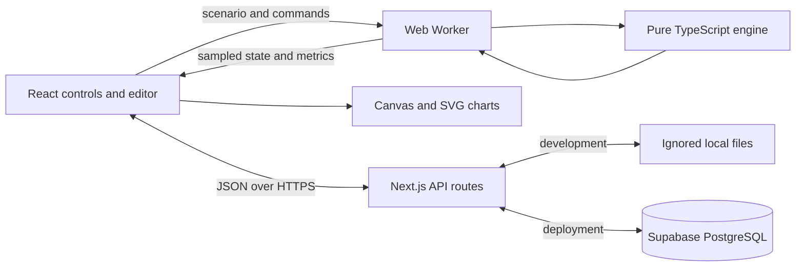

# Architecture

The application uses TypeScript throughout. A pure simulation engine runs in a
browser Web Worker. Next.js serves the React interface and short persistence
requests. Local development stores shared records in ignored files; production
uses Supabase/PostgreSQL.

## Components

| Part              | Implemented choice                         | Reason                                                                          |
| ----------------- | ------------------------------------------ | ------------------------------------------------------------------------------- |
| Interface and API | Next.js App Router, React, TypeScript      | One project and language for the web application.                               |
| Styling           | Plain CSS with shared theme variables      | Responsive panels without another styling build tool.                           |
| Network display   | Canvas 2D                                  | Draw roads and vehicles directly instead of a component per car.                |
| Charts            | Small native SVG components                | Two sampled charts need little infrastructure.                                  |
| Simulation        | Our own TypeScript engine                  | Explicit agent rules, graph topology, junctions, and measurements.              |
| Scheduling        | Web Worker and message protocol            | Keep calculation separate from input and drawing.                               |
| Validation        | Zod                                        | Check imported, edited, and shared data at runtime.                             |
| Persistence       | Local atomic files; Supabase HTTPS adapter | Works without credentials locally and with durable cloud storage at deployment. |
| Edit ownership    | Random private key, hashed on server       | Simple sharing without mandatory accounts.                                      |
| Tests             | Vitest, PGlite, Playwright, axe            | Engine, API, SQL, browser, and accessibility checks.                            |
| Deployment target | Vercel; Netlify alternative                | Next.js UI plus short API requests. Deployment not performed.                   |

The initial proposal suggested Tailwind, Recharts, accounts, and separate run
history. We kept this demo smaller: CSS, native charts, capability-based editing,
and one scenario record containing the latest summary. See
[implementation decisions](implementation.md) for the tradeoffs.

## Communication



Commands initialize, play, pause, reset, single-step, change playback speed,
perturb a vehicle, hold all signals red, and request results. Replies carry state,
metrics, errors, or experiment results. Run IDs reject stale messages after a
reset. Geometry edits restart the run. Vehicles update at a fixed 0.1-second
step; snapshots arrive at approximately 20 Hz and metrics are sampled once per
simulated second. Browser drawing uses requestAnimationFrame.

The backend does not advance live vehicles. It receives scenario records and
saved summaries through short requests. Large batch computations could use the
same engine in a separate job service later; no persistent WebSocket server or
long-running serverless simulation request is needed for this demo.

## Source boundaries

```text
src/
  simulation/   # schema, geometry, compiled lanes, routing, engine, presets
  workers/      # simulation scheduler and typed message protocol
  renderer/     # canvas drawing, selection, pan/zoom, node interaction
  features/     # controls, editor, charts, experiments, files, worker hook
  server/       # persistence adapters, public/private contracts, HTTP checks
  app/          # page, theme, and /api/scenarios routes
scripts/        # headless experiment runner
supabase/       # deployment SQL migration
e2e/           # browser workflows (at repository root)
doc/            # concepts, design, evidence, and deployment handoff
```

The engine has no React, Canvas, database SDK, or browser-global dependencies.
Geometry is compiled when the scenario changes; the renderer reuses it while
vehicles move. Validation bounds junction degree and network size to keep
compilation manageable. Lane-local ordering avoids scanning the whole network
for every neighboring vehicle.

## Data and persistence

- **Scenario:** schema version, name, network, demand, signal plans, duration,
  driver settings, seed, and ring population where relevant.
- **Vehicle:** route segment, position, speed, driver attributes, requested
  departure, actual entry, and junction-tail clearance.
- **Full local run export:** scenario, engine version, timestep, metrics, sampled
  time series, and tick-indexed interventions.
- **Shared record:** public ID, revision, scenario, latest summary, timestamps,
  and a private edit-key hash. Public responses omit private fields.

`POST /api/scenarios` creates a shared copy and returns its edit key once.
`GET /api/scenarios/:id` loads public data. `PUT` and `DELETE` require the private
key; updates also require the expected revision. No public listing endpoint is
provided. Browser-local saves and JSON/CSV exports are independent of this API.

Production API requests use a server-only Supabase service-role credential.
Database access by anonymous clients is revoked, with row-level security enabled.
Atomic database quotas coordinate limits across serverless instances. Local
files and in-process quotas are for local development, not durable serverless
storage. Inputs, JSON sizes, origins, and edit permissions are checked server-side.

Client-generated summaries are labeled as such. They are not independently
verified research results. The record holds the latest summary rather than an
unbounded history; full exports preserve individual runs outside the server.

## Limits and deployment

The UI supports 300 active cars, 40 nodes, 60 directed roads, up to four lanes
per road, and eight incident directed roads per junction. Excess departures
remain in external queues. These are bounded educational scenarios, not a claim
of city-scale browser performance. Hidden tabs pause automatically.

Vercel is the first deployment target. Netlify can use its Next.js runtime. Both
need the Supabase migration and server environment variables for durable sharing.
No filesystem database should be configured on those hosts. Setup and live
integration checks are in [deployment.md](deployment.md).
